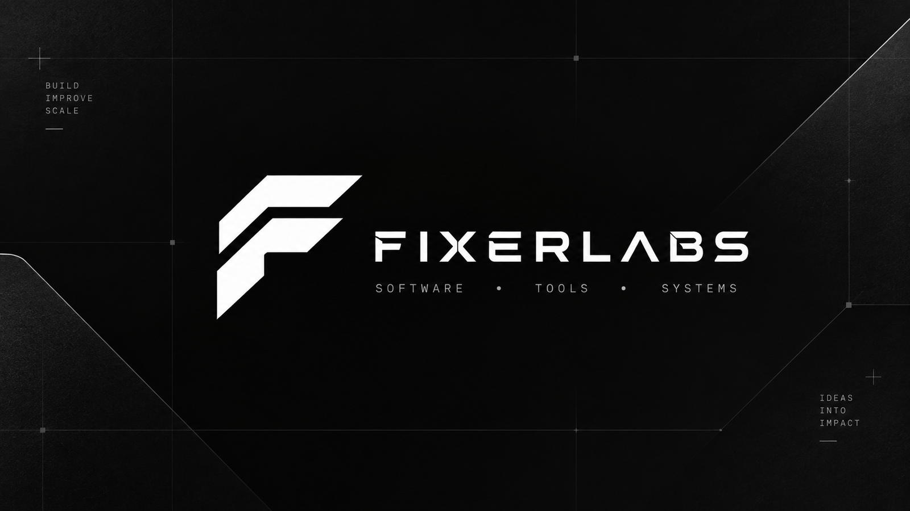
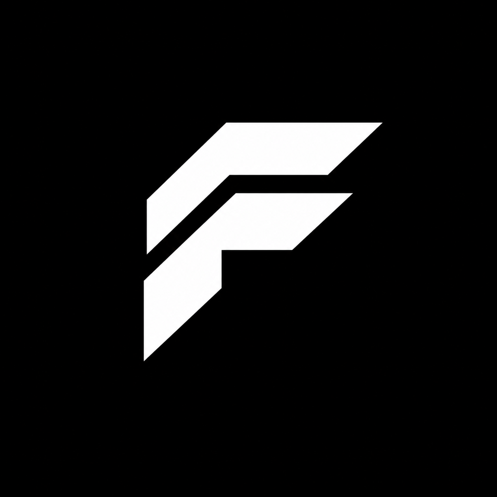

<p align="center">
  
</p>

<p align="center">
  <strong>Software · Tools · Systems</strong><br>
  Building focused technology for real problems.
</p>

<p align="center">
  <sub>Precision in the details. Practical by design. Built to last.</sub>
</p>

---

## FixerLabs

FixerLabs is an independent technology studio building software, developer tools, learning systems, and experimental platforms.

We focus on products that remove friction from real workflows: better tools for learning, cleaner software experiences, dependable local-first utilities, and infrastructure that helps those products work together.

Our work favors:

- **Useful over ornamental** — features should solve a real problem.
- **Local-first where it matters** — privacy, ownership, resilience, and portability are first-class considerations.
- **Reliable engineering** — predictable behavior, compatibility, testing, and graceful failure.
- **Focused interfaces** — powerful tools should still feel clear.
- **Long-term systems thinking** — projects should be able to grow without becoming fragile.

---

## Open source

| Project | What it is |
| --- | --- |
| **[AVTR-1 Multi-Platform Edition](https://github.com/Fixer-Labs/avtr-1-multiplatform)** | Runs the AVTR-1 lip-synced talking-head avatar on AMD (DirectML, ROCm), Apple Silicon (Metal) and NVIDIA GPUs without TensorRT. Exact graph rewrites and verified fp16 make it 2.5× faster on integrated GPUs with output matching the fp32 reference. An unofficial community port of [avaturn-live/avtr-1](https://github.com/avaturn-live/avtr-1). |

---

## Selected work

<sub>In private development. Public releases will be linked here.</sub>

| Project | What it is |
| --- | --- |
| **Rote** | A modern interface and experience layer for Anki, designed around clearer studying, truthful scheduling information, accessibility, and responsive workflows. |
| **LexiSearch** | Fast local search for Anki with exact, phrase, prefix, fuzzy, field, deck, tag, and note-type search. |
| **AddonPort** | Portable Anki environment backup, migration, inspection, selective restore, and device-to-device setup transfer. |
| **FixerDrop** | Cross-platform local transfer technology for moving files and product data between FixerLabs experiences. |
| **Spellwise** | Focused spell-checking tooling for Anki workflows, designed for fast review and dependable local use. |
| **Dev Preflight** | Local development validation and release-readiness tooling for catching issues before software ships. |

---

## Tools & infrastructure

Alongside the larger products, FixerLabs develops smaller utilities and engineering systems that support experimentation, studying, and product development.

<table>
<tr>
<td width="50%" valign="top">

### Learning & Anki

- **Contextual Lookup** — offline contextual dictionary and lookup tooling
- **FocusDock** — focused Pomodoro and study-session workflow
- **CardPace** — card-study workflow experiment
- **CardPulse** — card-review workflow experiment

</td>
<td width="50%" valign="top">

### Development & platform

- **Anki DevKit** — shared compatibility and development infrastructure
- **Fixer Mobile Runtime** — mobile runtime experimentation
- **XR Dev Monitor** — XR development and monitoring tooling

</td>
</tr>
</table>

---

## How we build

```text
problem
   ↓
prototype
   ↓
validate
   ↓
refine
   ↓
ship
   ↓
learn
```

We try to keep that loop short.

Projects are developed around explicit product goals, testable behavior, maintainable boundaries, and interfaces that expose useful information without unnecessary complexity.

---

## Current direction

FixerLabs is expanding from individual software projects toward a connected technology ecosystem spanning:

**software** · **developer tooling** · **education technology** · **local transfer** · **mobile** · **XR** · **future hardware**

The parent identity stays deliberately simple: black, white, precise, and product-neutral. Individual products can develop their own visual language without losing the connection back to FixerLabs.

---

<p align="center">
  
</p>

<p align="center">
  <strong>FIXERLABS</strong><br>
  <sub>Build · Improve · Scale</sub>
</p>
